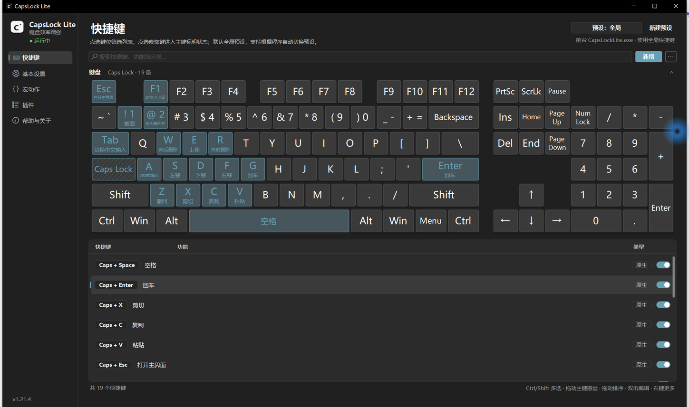

# CapsLock Lite

[简体中文](README.md) · [English](README.en.md)

[](https://github.com/jiekemt/CapsLockLite/releases)
[](LICENSE)
[](#)

A lightweight Caps Lock enhancement tool for Windows, inspired by [Capslock+](https://capslox.com/capslock-plus/). Tap **Caps Lock** to toggle caps as usual; hold it and press other keys to move the cursor, select text, delete, copy and paste. Everything is configurable from a graphical UI.

Version **1.26.1**. This is an independent implementation, **not an official Capslock+ release**. It does not include Qbar, WinBind or TabScript.



## Features

- **Caps Lock as a modifier prefix** — tap to toggle caps; combinations only fire while Caps Lock is held.
- **Hold-to-repeat** — each shortcut can fire once or repeat at 30 Hz. "Send keys" keeps a real key held down: keydown stays pressed, repeat keydowns are sent, and a single keyup is sent on release.
- **Familiar default keys** — arrows, selection, deletion, line start/end, clipboard and calculator, based on the classic Capslock+ layout.
- **Keyboard as UI** — the shortcuts page renders a full 104-key keyboard. Click a modifier to filter, click a key to filter the list, drag a key to move its bindings, double-click to edit.
- **Custom combinations** — `Caps + key` or `Caps + Ctrl/Alt/Shift/Win + key`. No system-wide hotkeys are registered, so CapsLock Lite does not fight other programs for key combinations.
- **Mouse as a main key** — `Caps + left / right / middle click` and `Caps + wheel up / down` can run any action. Mouse buttons support hold-to-repeat like keys; a wheel notch has no release, so it fires once per notch.
- **Mouse card** — the shortcuts page draws a mouse with five zones next to the list. Zones filter, double-click to edit and open the same right-click menu as keycaps, and shortcuts can be dragged between the board and the mouse in both directions.
- **Per-program presets** — bind another shortcut table to a process; it switches automatically when that program is in the foreground.
- **Macros** — chain built-in actions, plugin actions and other macros with per-step delay and repeat count.
- **Plugins** — add actions with a single C# file. Plugins are only compiled and executed after you explicitly trust their SHA-256; trust is revoked automatically when the file changes.
- **Fluent UI** — light/dark themes, system accent color, rounded windows, custom-drawn lists, dialogs and menus. Per-monitor V2 DPI aware.
- **Local and private** — JSON config, import/export, no network requests and no telemetry.
- **Tray resident** — close the window to keep it running; pause, reload or quit from the tray.

## Install

1. Download `CapsLockLite-v1.26.1-win64.zip` from [Releases](https://github.com/jiekemt/CapsLockLite/releases/latest).
2. Extract and run `CapsLockLite.exe`. It is a single portable executable; no installer is required.
3. Verify the download against `CapsLockLite-SHA256.txt` in the package if you like.
4. If the original Capslock+ is also running, quit it first so only one program captures Caps Lock.

Windows 10/11 already ships .NET Framework 4.8. There is no code signature: SmartScreen may warn about an unknown publisher, which is common for low-level keyboard hook tools. Build from source if you prefer.

## Default shortcuts

All combinations are prefixed with Caps Lock. A short sample:

| Keys | Action |
| --- | --- |
| `E / D / S / F` | Move up / down / left / right |
| `I / K / J / L` | Select up / down / left / right |
| `P / ;` | Line start / end |
| `W / R` | Delete word backward / forward |
| `X / C / V` | Cut / copy / paste |
| `F1` | Open CapsLock Lite |
| `F2` | Windows Calculator |
| `F9 / F10 / F11` | Mute / volume down / up |

The full list, including selection, deletion, window and media actions, is documented in the [Chinese README](README.md#默认键位).

## Custom shortcuts

Open the **Shortcuts** page and click **Add**. Pick the modifier chips (`Caps Lock`, `Ctrl`, `Alt`, `Shift`, `Win`), click the **main key** box and press the key you want. `Caps Lock` must stay checked: the app only supports the Caps layer and never registers a system-wide hotkey.

The main key can also be a mouse button — **left, right, middle** — or the **wheel (up / down)**. Click the box once to start recording, then press the key or the mouse button; the recording swallows that single input so it cannot click anything else in the dialog. Recording ends after one capture, so the dialog buttons work normally again; click the box again to re-record. Mouse buttons support hold-to-repeat. A wheel notch has no release event, so wheel shortcuts are always single-shot and the trigger mode is locked to **press to fire**.

Shortcuts can be dragged between the keyboard and the mouse card: with a chord selected, drag a cap onto a mouse zone or a zone onto a cap; the target highlights and releasing moves every shortcut on that chord. Conflicting targets ask before overwriting.

## Optional driver backend

Shortcuts are sent with `SendInput`, which desktop programs accept. Games that read raw devices (Raw Input / DirectInput) never see injected events, so a shortcut can do nothing there. CapsLock Lite can send through the [Interception](https://github.com/oblitum/Interception) keyboard/mouse filter driver instead:

1. Install the Interception driver (`install-interception.exe /install`, elevated, then reboot).
2. The release package already ships the 64-bit `interception.dll` next to `CapsLockLite.exe`; when building from source, copy it from `third_party/interception/x64/`.
3. Settings → Behavior → **Injection** → **Driver (Interception)**, or keep **Auto** to use the driver whenever it is detected.

The full guide — download, install, enable, verify and troubleshooting, plus how to uninstall — is in [DRIVER-SETUP.md](DRIVER-SETUP.md) (Chinese).

Capture is unchanged: the Caps layer still runs on the low-level hook, only the outgoing strokes take a different path. If the driver or the DLL is missing the app falls back to `SendInput`, says why in the status bar and keeps working. A driver is a kernel component: it needs installing, core isolation may refuse it, and it changes how security software and anti-cheat see the app. Leave the default if you do not need it.

## Build from source

Requirements: Windows 10/11 and .NET Framework 4.8. No Visual Studio or NuGet needed — the build script uses the system `csc.exe`.

```powershell
powershell -NoProfile -ExecutionPolicy Bypass -File .\build.ps1
.\dist\CapsLockLite.exe --selftest
```

Output: `dist\CapsLockLite.exe`; self-test results go to `dist\selftest.log`.

Packaging:

```powershell
powershell -NoProfile -ExecutionPolicy Bypass -File .\package.ps1
```

See [SOURCE.md](SOURCE.md) for the architecture and [CONTRIBUTING.md](CONTRIBUTING.md) before sending a pull request.

## Plugins

A plugin is a single C# file that adds one or more actions. Open the **Plugins** page and import a `.cs` or `.zip` file. CapsLock Lite compiles it and shows its SHA-256; nothing runs until you click **Trust**. Modified files lose trust automatically.

The plugin contract and samples are documented in [PLUGIN.md](PLUGIN.md) (Chinese). Example plugins live in [`samples/plugins/`](samples/plugins/).

> Plugins run in-process with the full privileges of your user account. There is no sandbox. Only trust code you have read and whose origin you trust.

## Configuration

`%APPDATA%\CapsLockLite\settings.json` — falls back to `%LOCALAPPDATA%` or the user temp directory when `%APPDATA%` is not writable. Logs are written to `error.log` in the same directory.

## Known limitations

- No Qbar / WinBind / TabScript / online translation API.
- Some games, anti-cheat, remote desktop and security software may block low-level keyboard or mouse hooks; mouse triggers stop working if the mouse hook is refused.
- Games that read raw device input need the optional driver backend (see above); without it their injected-shortcut events are ignored.
- The driver backend uses a third-party component: the release package bundles Interception's 64-bit user-mode client library (`interception.dll`, LGPL 3.0, unmodified) with its license text. The kernel driver and its installer are not bundled.
- Programs running as administrator usually do not receive simulated input from a non-elevated process; run CapsLock Lite as administrator if needed.
- `F3` sends `Ctrl+C` before opening Bing Translator — avoid it in terminals.
- The binary is unsigned; see [SECURITY.md](SECURITY.md) for the threat model.

## Contributing

Issues and pull requests are welcome. Please read [CONTRIBUTING.md](CONTRIBUTING.md) and [CODE_OF_CONDUCT.md](CODE_OF_CONDUCT.md). Report security issues privately as described in [SECURITY.md](SECURITY.md).

## Credits and license

- Default layout and feature scope reference the [Capslock+ documentation](https://capslox.com/capslock-plus/) by 陈俊凯.
- This project is an independent implementation and is not affiliated with the Capslock+ author; it contains none of their code or icon assets.
- Licensed under the [MIT License](LICENSE).
