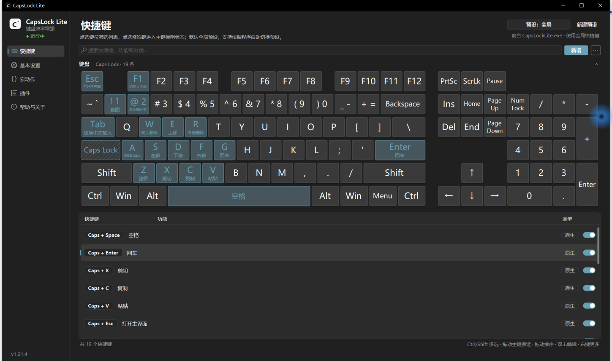

# CapsLock Lite

[简体中文](README.md) · [English](README.en.md)

[](https://github.com/jiekemt/CapsLockLite/releases)
[](LICENSE)
[](#)
[](#从源码构建)

一个受 [Capslock+](https://capslox.com/capslock-plus/) 启发的 Windows 简化版工具：短按 **Caps Lock** 仍然切换大小写，按住它再按其他键则可以移动光标、选择文字、删除、复制粘贴，并且提供图形化界面来重新录制快捷键、修改动作和新增组合键。

当前版本 **1.26.1**。本程序是独立实现，**不是 Capslock+ 的官方版本**，也没有包含 Qbar、WinBind、TabScript 等高级功能。



## 特点

- **Caps Lock 作为组合键前缀**：短按切换大小写，长按不操作。
- **按住连发**：在映射设置里可选“按下单发”或“按住连发”；连发为每秒 30 发，方向、选择、删除和“发送按键”等动作支持连发。“发送按键”的连发是真实键盘式长按：按下即保持 keydown，之后每 33ms 再发一次 keydown，松开才发唯一一次 keyup；其他动作是重复执行。
- **保留 Capslock+ 的基础键位**：方向、选择、删除、行首行尾、复制粘贴、系统计算器等。
- **图形化设置界面**：新增、编辑、删除、启用/停用、搜索、恢复默认；列表的「类型」列区分原生动作、插件动作和宏动作。
- **键盘即界面**：快捷键页直接渲染完整 104 键键盘；点选功能键后按「精确组合」标注对应键位与动作名，没有选中功能键时键盘保持中性，键盘区可收起，新增、启停、编辑、删除都在同一页完成。
- **自定义组合键**：Caps + 任意键，或 Caps + Ctrl/Alt/Shift/Win + 任意键。触发方式固定为 Caps 层，不注册系统级全局热键，避免与系统和其他程序抢键。
- **鼠标也能当主键**：`Caps + 鼠标左键 / 右键 / 中键`、`Caps + 滚轮上滑 / 下滑` 都可以绑定动作。鼠标键和键盘一样支持按住连发；滚轮没有“松开”，所以每滑一格触发一次，只支持“按下单发”。
- **鼠标卡片**：快捷键页右侧渲染一只鼠标，五个热区与键位一样可点选筛选、双击编辑、右键菜单；键盘和鼠标之间可以直接拖动搬运快捷键。
- **多种动作**：发送按键、输入文本、运行程序、打开文件夹/网址、窗口置顶/透明/贴边、媒体与音量控制等。
- **开机启动**：优先写入当前用户注册表；受限环境下尝试启动文件夹；被系统拒绝时会提示原因。
- **托盘常驻**：关闭主窗口后继续在后台运行，可暂停、重载或退出。
- **深色模式**：浅色/深色即时切换，主色、开关和 Logo 同步反色。
- **多显示器自适应**：窗口在不同缩放比例的显示器之间移动时，按新 DPI 重新排版。
- **插件（只认信任）**：信任某个 C# 插件文件后，插件动作可在快捷键里绑定，无需重启；导入/编译不会在信任前执行插件代码；附带截图插件示例。
- **本地配置**：JSON 格式，支持导入/导出，无网络请求、无遥测。

## 快速开始

从 [Releases](https://github.com/jiekemt/CapsLockLite/releases/latest) 下载 `CapsLockLite-v1.26.1-win64.zip`，解压后运行 `CapsLockLite.exe`（单文件，无需安装）。下载后可对照包内的 `CapsLockLite-SHA256.txt` 校验文件。

1. 运行 `CapsLockLite.exe`。
2. 如果同时安装了原版 Capslock+，请先退出原版，避免两个程序同时拦截 Caps Lock。
3. 在任意文本框里按住 `Caps Lock`，再按 `E / D / S / F` 试试移动光标。
4. 短按 `Caps Lock` 切换大小写；按住超过 350 毫秒且没有按其他键，则不会触发短按动作。
5. 右键系统托盘图标可以暂停、重新加载或退出。

> Windows 10/11 通常已经自带 .NET Framework 4.8，无需额外安装运行库。

## 界面

界面按 Windows 11 的 Fluent 风格重做：左侧导航 + 右侧内容，卡片式分组、系统强调色、圆角窗口与明暗双主题。窗口默认按屏幕大小开得足够宽，拖动改变尺寸后会记住，下次启动沿用。提示与确认框也是自绘的：图标与正文直接排在 `Surface` 底色上，操作行上方一条细线，按钮样式与主界面一致，不再出现系统 `MessageBox` 的方角灰底。

### 快捷键页

页面自上而下是「搜索栏 + 新增 + ⋯」、键位键盘、快捷键列表。

- 顶部搜索框按快捷键、动作名或动作 ID 实时筛选。
- 键盘区默认展开，完整渲染美式 104 键布局。没有选中修饰键时它是一张总览：所有被快捷键用到的主键带浅色底，右下角**正圆**小徽标里的数字是**该键上的动作数量**（不分组合键，也不区分启用状态），所有键（含空格）位置一致；窗口宽度不够时徽标让位于浅色底，只保留「该键被使用」的提示。这个状态下可以用鼠标点选主键，把下方列表筛到该键；双击按两次点选处理（选中 → 取消），不会出现「点了没反应」；右键主键可直接「新增到该键位」，进入的编辑页默认不勾选任何修饰键，由你自己挑组合。
- 修饰键就是筛选开关：点键盘上的 `Caps Lock` / `Ctrl` / `Alt` / `Shift` / `Win` 选中，再点一次取消。只有与所选组合**完全一致**的快捷键才会被标注——只选 `Caps Lock` 时，`Caps + Alt + …` 的键位不会亮；再选上 `Alt` 后才标 `Caps + Alt` 的组合。这样每个键位在同一时刻至多对应一条动作。选中的修饰键会盖上一层斜线遮罩，与「该键位有快捷键」的填充高亮区分开。
- 拖动键位搬运：选中修饰键后，把有动作的主键拖到另一个主键上，会把该键在这一组合下的全部快捷键整体搬过去。拖动时卡片跟着指针走、尺寸与键帽完全一致（不放大）、只把键名藏起来、动作名保持在键帽上的原位置与字号、源键压暗、目标键亮强调色边框；按 `Esc` 放弃，松手即落位。目标键已有同组合的快捷键时先确认覆盖，落位后列表自动筛到目标键，并提示「已把 N 条快捷键从 X 移到 Y」。未选修饰键时键位不可拖——那个状态它只负责筛选列表。
- 键位剪贴板：选中修饰键和键位后，`Ctrl+X` / `Ctrl+C` 剪切或复制该键上的快捷键，换一个键再 `Ctrl+V` 粘贴；右键菜单里也有「剪切 / 复制 / 粘贴到 X」。剪贴板是程序内的，不动系统剪贴板；粘贴总是落到「当前选中的组合」——在 Caps 层复制、切到 Caps + Alt 再粘贴，得到的就是 Caps + Alt 的那一条，目标键已有同组合时先确认覆盖。
- 行剪贴板：焦点在列表上时，`Ctrl+C` / `Ctrl+X` 复制或剪切选中的行，`Ctrl+V` 粘贴成新行（新 id，组合、动作、参数、命名、触发方式全部带上）。粘贴落在最后选中行之后，没有选中行时接在末尾；剪切后再粘贴会回到剪切前的位置，粘贴出来的行会被选中。与已有快捷键同组合时状态栏会提示「只有靠前的会触发」。两条剪贴板互不干扰：焦点在键盘上时 `Ctrl+C` 走键位剪贴板（整条组合），焦点在列表上时走行剪贴板，右键菜单里两边都有对应项。
- 撤回与重做：`Ctrl+Z` / `Ctrl+Y`（或 `Ctrl+Shift+Z`）对整个快捷键页生效，新增、编辑、删除、启停、拖动排序、键位搬运、剪切/复制后的粘贴、恢复默认都能一步步退回；「⋯」菜单里也有「撤回 / 重做」。切到别的页面再回来、或在键盘和列表之间切换，撤回栈都保持连续。
- `Del` 是页面级命令：焦点不在列表上也能删——有选中行时删除列表选中的行，没有选中行时删除当前键位（已选修饰键 + 主键）上的快捷键，都会先确认。切回快捷键页时焦点会自动回到列表，`Del` / `Enter` / 方向键立刻可用。
- 程序预设：快捷键页右上角是「预设：全局」，默认对所有程序生效。「新建预设」会复制一份全局快捷键、清空绑定并立刻让你选程序——列表里是正在运行的程序，也可以「浏览…」选 exe；绑定后，那个程序在前台时自动改用这套快捷键，页面上的列表与键盘也随之切换。预设菜单里可以「绑定 / 更换程序…」「删除预设」，按钮下方一行实时显示前台程序与当前生效的表。按钮宽度固定，程序名太长时在按钮里省略显示，不会顶出边框；点开菜单再收起不会在按钮上留下高亮框。
- 被标注的键帽会显示该键调用的动作名（如「上移」「清空当前行」）：每个键按自己的宽高单独挑字号，放得下就完整显示，放不下就用 `…` 截断超出部分；键太小时只保留高亮。数字键把上档符号与数字排成一行（中间留空格）并居中，动作名另起一行；不再上下堆两行，小窗口下也不会被键帽下沿切掉。
- **存在但已停用**的组合键不是实色高亮，而是灰色底 + **反向斜线**遮罩（修饰键用 `/`，停用用 `\`），动作名也变灰；启用、停用一眼可分。
- 点选一个键位即筛选该键的快捷键，再点一次取消；点选修饰键等同于重新选择，之前选中的键位会一起取消（与点选另一个键位手感一致）。`Esc` 依次清除键位筛选、修饰键筛选和搜索词。
- 双击键位直接打开该键的快捷键编辑页；一个键位上有多条组合键时，先弹出选择菜单再进入编辑。已选修饰键时，双击一个还没有快捷键的键会直接「新建到该键位」（修饰键沿用当前选择），不用先右键。双击按 300ms 的短窗口判定，两下慢一点就是两次普通点选；拖动搬移之后也能立刻双击同一个键进入编辑。总览状态（未选修饰键）没有可编辑的组合，双击就完整执行两次点选，编辑仍需先选修饰键。
- 列表与键盘是同一份数据：双击列表条目编辑、`Space` 启停当前行、`Del` 删除（焦点不在列表时按当前键位删除）；右键列表条目弹出「编辑 / 停用 / 删除 / 新增」菜单，右键键盘可直接「新增到此键位」，改动立刻同步。
- 列表支持批量操作：`Ctrl` 点选切换单行、`Shift` 连选一段、`Ctrl+A` 全选（筛选/搜索过后只选当前可见的行），方向键配合 `Shift` 扩展选择；多选后右键换成「启用选中 (n) / 停用选中 (n) / 删除选中 (n)」，删除只确认一次，底部会写「已选 N 条 · 共 M 条」。
- 拖动排序：按住选中的行（可整块多选）上下拖动即可换位置，整块跟着指针走、其余行做位移动画，插入位置有强调色横线，靠近边缘自动滚动；**只在按住左键期间拖动，一松手立刻落位**，之后移动鼠标不会再拖着一块走。落位后顺序立即写回配置并提示「已调整 N 条快捷键的顺序」。行尾开关只翻自己那一行，不受多选影响。
- 列表空白处右键也有菜单，不必先点中某一行：快捷键页是「新增快捷键 / 全选 / 搜索快捷键… / 刷新列表」，插件页是「导入插件… / 重新加载插件 / 打开插件目录 / 全选」。
- 每行右侧就是该组合的开关；`⋯` 菜单与界面共用同一套圆角卡片样式，里面有新增、收起键盘、恢复默认、导入/导出与配置文件入口。
- 总开关就是左侧栏顶部的软件 Logo：点一下暂停全部快捷键，再点恢复；暂停时 Logo 变灰、状态指示显示「已暂停」，深色与浅色模式都按各自的 Logo 做灰化。Logo 有轻微的立体感（投影 + 高光 + 内描边），按下时会下沉并变暗，松开回弹，像按实体键一样。运行状态指示在侧栏标题下方，快捷键页的预设选择器在右上角，只在这一页出现。

### 设置

设置页用分段控件分为「外观 / 行为 / 启动与数据」，每段一屏可见，不需要滚动。

- **外观**：深色模式；强调色跟随 Windows 系统设置。
- **行为**：短按 Caps Lock 的动作（切换大小写 / 发送 Esc / 切换输入法（Win + Space）/ 不操作）、长按判定时间 150–2000 毫秒、注入方式（系统注入 / 可选驱动注入，见下文）。
- **启动与数据**：开机自启动、启动时最小化、配置文件路径，以及配置文件 / 导出 / 导入 / 复制路径。

### 宏动作

导航栏的「宏动作」把多个动作串成一段可以重复使用的脚本：动作可以来自内置动作、插件动作，也可以是另一个宏。宏保存后就是一个普通动作，在快捷键编辑页的「执行动作」里按名字挑选即可绑定。

- 新建后先起名字（重名会被挡下），再往步骤列表里「添加动作…」；宏动作本身也在动作库里，嵌套直接选它即可，没有单独的「添加宏」。
- 选择动作页可以先按「全部 / 原生 / 插件 / 宏」筛选；插件动作的分类统一带「插件 · 」前缀，「启动与输入」「鼠标」「其他」排在最前，常用的先看到；切换筛选只刷新列表，不会替你选中第一行（原选中项仍可见则保留）。
- 每个步骤都能设「执行后等待」的毫秒数与「重复次数」（等待默认 50 毫秒）：等待是这一步做完到下一步开始之间的间隔，次数是这一步重复执行几遍。说明文字按窗口宽度换行、窗口高度随行数增长，插件作者的说明再长也不会压住参数框。
- 每个步骤还可以起一个「命名」（可空）：填了之后步骤列表的动作列只显示这个名字，不再显示动作名，参数列照旧显示参数；没填就还是显示动作名。
- 步骤列表支持与快捷键列表一致的多选、拖动排序、`Delete` 删除、右键菜单，另外加了 `Ctrl+X` / `Ctrl+C` / `Ctrl+V` 剪切、复制、粘贴（也行内右键菜单触发），方便拼较长的脚本；编辑页的 `Ctrl+Z` / `Ctrl+Y` 可以撤回/重做这些步骤改动，右键菜单里也有「撤回 / 重做」。
- 页面顶部「运行 / 结束」可以手工试跑当前宏；运行中的那一行会显示「运行中」，结束时提示「已结束宏“名字”」。绑定到快捷键后，按组合键同样会执行。
- 宏可以嵌套宏，但不会允许循环（会提示「检测到循环引用…」）；嵌套最深 8 层，一次运行最多 10000 步，超出会自动停止。
- 同一时间只运行一个宏：宏还没跑完时，再按别的宏快捷键不会打断它、也不会排队叠加，只在状态栏提示「宏“名字”正在运行，结束后才能触发下一个宏」；想换一个宏，先在宏动作页点「结束」或「⋯ → 结束运行」。
- 编辑页的「执行后返回鼠标原位置」开关（默认关）打开后，宏开始前会记下光标位置，结束时无论跑完、手动结束还是出错停止，都会把光标放回原处。
- 「⋯」菜单支持导入、导出当前宏或全部宏，文件是 `.clmacro` 的 JSON 文本，一个文件里可以放多个宏；宏文件不包含代码。

### 鼠标点击

内置动作「鼠标点击」把光标移到指定的桌面坐标并点一下，适合让快捷键去点别的软件里的按钮。

- 支持左键、中键、右键；坐标用**虚拟屏幕坐标**（多显示器时可以为负），范围 -32768～32767。
- 参数行左侧叫「点击设置」。可以勾选 `Ctrl`、`Alt`、`Shift`、`Win`：点击时按住勾选的修饰键（例如做「Ctrl + 点击」的多选、或「Shift + 点击」的连选），点完自动松开。快捷键页和宏步骤页用的是同一套开关，两边行为一致。
- 参数行里的「抓取坐标」会把 CapsLock Lite 的窗口先移到屏幕外，把鼠标移到目标位置后按一下 **CapsLock** 记录坐标并恢复窗口；按 `Esc` 取消。窗口不在屏幕上的期间 CapsLock 只用于确认，不会切换大小写，也不会触发软件自己的快捷键。
- 动作在动作库里显示为「鼠标 · 鼠标点击」，参数在列表里显示为「左键 (100, 200)」；勾了修饰键则显示为「Ctrl + Shift + 左键 (100, 200)」。
- 点击**不含悬停等待**：光标移到坐标后立即按下。需要「移过去等菜单展开再点」的场景，用下面的「鼠标移动」加一步，把等待时间写在步骤的「执行后等待」里。

### 鼠标移动

内置动作「鼠标移动」只把光标移到指定坐标，不点击、不等待，适合两件事：

- **悬停**：先移过去，再给这一步设置「执行后等待」（例如 200ms），让下拉菜单/工具提示展开，然后下一步再点。
- **纯定位**：只想把光标放回某个位置，或想让后续几次点击都围绕同一个基准点。

坐标同样用**虚拟屏幕坐标**，参数行叫「目标坐标」，只有 X / Y 和「抓取坐标」，没有按键和修饰键；列表里显示为「鼠标移动：(100, 200)」。宏步骤里它也占一行，等待时间用步骤自己的「执行后等待」表达，悬停多久一眼能看见。
### 宏运行时的指针保护

执行鼠标动作期间（点击的那几十毫秒，以及「鼠标移动」之后的等待时间，最长 2 秒），CapsLock Lite 会**把光标钉在动作指定的点上**：这期间你手动移动鼠标不会把光标带走，因此宏不会点到别的地方。规则是按距离判断的——落在目标点 ±2px 内的移动放行（程序自己定位光标走的就是这条路），其余吞掉。

- 只影响**指针移动**，不影响键盘；用户在这期间的点击不在保护范围内。
- 钉住一定会过期（点击 400ms、悬停 2s 上限），宏结束、退出程序时也会立刻解除，不会把鼠标锁死。
- 想确认是否发生过拦截：`error.log` 里会写「指针钉住：为保护鼠标动作，拦截了 N 次鼠标移动」。

### 深色模式

在「设置 → 外观」打开「深色模式」会立即切换，配置保存到 `settings.json`。
深色模式使用深灰背景与自动提亮的强调色，Logo 切换为反色版本。

### 注入方式（可选驱动）

快捷键默认用系统 API（`SendInput`）发送，桌面程序都认。但游戏常用 Raw Input / DirectInput 直接读设备，系统注入的事件它们收不到，表现为「按了没反应」。「设置 → 行为 → 注入方式」可以改走 [Interception](https://github.com/oblitum/Interception) 键鼠过滤驱动：

1. 安装 Interception 驱动（管理员运行 `install-interception.exe /install`，装完**重启**）。
2. 发布包里已经带好了 64 位的 `interception.dll`（就在 `CapsLockLite.exe` 旁边）；从源码构建的话，把它从 `third_party/interception/x64/` 复制过去即可。
3. 「注入方式」选「驱动注入（Interception）」；默认的「自动」会在检测到驱动时优先使用它。

完整的**下载、安装、启用与排查步骤**见 [DRIVER-SETUP.md](DRIVER-SETUP.md)（含常见失败原因、怎么确认驱动生效、以及卸载回退）。

拦截方式不变：Caps 层仍由低层钩子处理，只有发出去的按键换了通路，因此驱动侧的输入不会绕过你的快捷键。找不到驱动或 dll 时会自动退回系统注入，并在状态栏说明原因，其余功能不受影响。驱动属于内核组件，需要安装，可能被「内存完整性 / 核心隔离」拒绝，也会改变杀毒软件与反作弊程序对本程序的判断；不需要时保持默认即可。

## 快捷操作

| 快捷键 | 作用 |
| --- | --- |
| `Ctrl + N` | 新增快捷键 |
| `Ctrl + F` | 聚焦搜索框 |
| `Ctrl + D` | 切换深色模式 |
| `Ctrl + E` / `Enter` | 编辑选中的快捷键 |
| `Space` | 启用 / 停用选中的快捷键 |
| `Delete` | 删除选中的快捷键 |
| `↑` `↓` `PageUp` `PageDown` `Home` `End` | 在列表中移动 |
| `F5` | 重新加载配置 |
| `Esc` | 清空搜索 / 取消键位与修饰键筛选 / 关闭对话框 |

## 默认键位

首次启动会生成 57 条默认快捷键（可在 `⋯` 菜单里「恢复默认」重建，也可导出成 JSON 备份）。以下组合都省略了 `Caps Lock` 前缀，例如 `E` 表示按住 Caps Lock 再按 E。

### 移动

| 按键 | 功能 |
| --- | --- |
| `E / D / S / F` | 上 / 下 / 左 / 右移动 |
| `Alt + S / F` | 按单词向左 / 右移动 |
| `P / ;` | 行首 / 行尾 |
| `Alt + P / ;` | 页首 / 页尾 |

### 选择

| 按键 | 功能 |
| --- | --- |
| `I / K / J / L` | 向上 / 下 / 左 / 右选中 |
| `Alt + I / K` | 向上 / 下选中 3 次 |
| `Alt + J / L` | 向左 / 右选中 5 次 |
| `H / M` | 向左 / 右选中单词 |
| `Alt + H / M` | 向左 / 右选中单词 3 次 |
| `N` | 选中当前单词 |
| `Alt + N` | 选中当前行 |
| `U / O` | 选中到行首 / 行尾 |
| `Alt + U / O` | 选中到页首 / 页尾 |

### 删除与编辑

| 按键 | 功能 |
| --- | --- |
| `W / R` | 向后 / 向前删除 |
| `Alt + W / R` | 向后 / 向前删除单词 |
| `[` / `/` | 删除到行首 / 行尾 |
| `Alt + [` / `Alt + /` | 删除到页首 / 页尾 |
| `Backspace` | 清空当前行内容 |
| `Alt + Backspace` | 删除全部内容 |
| `Space` | 输入空格 |
| `Enter` | 回车 |
| `G / Alt + G` | 回车 |
| `Alt + Space` | 输入空格 |
| `Alt + Enter` | 回车 |

### 剪贴板

| 按键 | 功能 |
| --- | --- |
| `X / C / V` | 剪切 / 复制 / 粘贴 |

### 功能键

| 按键 | 功能 |
| --- | --- |
| `F1` | 打开 CapsLock Lite 主界面 |
| `F2` | 打开 Windows 计算器 |
| `F3` | 复制选中文字并用浏览器打开必应翻译 |
| `F4` | 切换当前窗口半透明 |
| `F5` | 发送 F5（刷新当前窗口） |
| `F6` | 切换当前窗口置顶 |
| `F8` | 复制选中文字并生成 JavaScript 转义字符串 |
| `F9` | 静音 |
| `F10 / F11` | 音量减小 / 增大 |

## 自定义快捷键

1. 打开“快捷键”页，点击“新增”。
2. 勾选需要的修饰键：`Caps Lock`、`Ctrl`、`Alt`、`Shift`、`Win`。
3. 点击“主键”输入框，然后按下要使用的键；主键也可以是**鼠标左键、右键、中键或滚轮**。滚轮在主键框里滑一下即可录成“滚轮上滑 / 滚轮下滑”。
   - 必须勾选 `Caps Lock`：按住 Caps Lock 再按主键触发。未勾选时保存会被拒绝——程序只支持 Caps 层，不注册系统级全局热键。
   - 按住 Caps Lock 时，没有绑定动作的主键不输出原功能（整层静默），避免组合键打错却打出一串字符；鼠标只在确实绑定了该按键时才被拦截，没有绑定的鼠标键照常工作。
   - 修饰键与 Caps Lock 的先后顺序不限：可以先按住 `Ctrl/Alt/Shift/Win` 再按 Caps Lock。Caps Lock 按下的一刻，这些修饰键会从前台程序那里收回，松开 Caps Lock 时再还回去——所以 `Caps + Alt + Q` 发送 `F4` 时，目标程序收到的是 `F4`，不会变成 `Alt + F4`。
   - 同时按住多个主键时以「最后按下的为准」，但**先按下的键不会松开**：新主键只接管连发，旧主键在目标程序里继续保持着按下状态，直到你抬起它。这正是游戏里「按住前进 + 点左右」需要的效果——像真实键盘一样，先按住 `Caps + E` 再按 `Caps + D`，两个键同时生效，光标不会卡住，动作也不会叠在一起。
4. 在“执行动作”里选择动作；如果动作需要参数（重复次数、程序路径、网址、文本、发送按键），会显示对应的输入控件。
5. 在“触发类型”中选择“按下单发”或“按住连发”。按住连发为每秒 30 发，仅对方向、选择、删除、发送按键等可重复动作开放。其中“发送按键”按真实键盘的长按语义发送：keydown 保持、按系统连发节奏重复 keydown、松开才 keyup。
6. 点击“保存”。如果组合键已被使用，会提示是否停用旧组合。

快捷键可以在键盘和鼠标之间拖动：先选中组合（勾选 Caps Lock），按住一个键拖到鼠标热区上，或者反过来从热区拖到某个键帽，目标会高亮，松手即把该组合下的全部快捷键搬过去；目标已有同组合时会先确认覆盖。

鼠标触发和键盘走同一条 Caps 层：按住 `Caps Lock` 时，绑定了动作的鼠标键/滚轮会被拦下来执行动作，`Caps + Ctrl/Alt/Shift/Win + 鼠标键` 也一样生效。录制时先点一下主键框进入录制状态（框里显示“等待按键或鼠标”），再按键或按鼠标：接下来这一次输入会被主键框吃掉，所以不会顺带点到别的控件；录完一次后录制状态自动关闭，界面上的按钮又能正常点击，想重录就再点一下主键框。滚轮在主键框里滑一格即可录成“滚轮上滑 / 滚轮下滑”，它没有“松开”事件，因此“触发类型”会锁定为“按下单发”。

### 可用动作

- 光标移动、选择、删除（整行、整段、全部内容这类多步操作）。
- 窗口置顶、半透明、最小化、最大化、关闭、贴左、贴右。
- 打开 CapsLock Lite 主界面、Windows 计算器、翻译、转义、切换大小写。
- 媒体上一曲/下一曲/播放暂停、音量加/减/静音。
- 运行程序或打开文件、打开文件夹、打开网址、输入文本、发送自定义按键。

单键就能完成的动作（行首/行尾、翻页、撤销/重做、复制/剪切/粘贴、回退/删除等）已经统一到「发送按键」：在动作里选「发送按键」再录 `Home`、`Ctrl + Z`、`Ctrl + C` 这类组合即可，按住连发也自然是真实键盘的长按语义。

方向键同样可以当发送键：在主键框里直接按 `↑` `↓` `←` `→`，保存后按组合键发送的是方向键本身（不会移动焦点）。

「发送按键」还可以写一段可选的**注释**：填了注释，快捷键列表的「功能」列就显示注释（例如「复制」）；没填就只显示组合键本身（例如 `Ctrl + C`），不再出现「发送按键：」前缀。

编辑「发送按键」时，修饰键、主键和实时预览直接排在快捷键编辑页里，不用再打开小弹窗；注释就在下面一行，留空即可。新建的「发送按键」（快捷键或宏步骤）默认不勾任何修饰键、也没有主键，需要你按一下想发送的键才确定组合，未设置时不会误发 `Ctrl + C`。方向键（上/下/左/右）也已并入「发送按键」，`Caps + E/D/S/F` 默认仍是上/下/左/右，只是列表里显示为「上移」这类名称。在主键框里按 `Esc` 或 ↑↓←→ 会直接录成键位，不会关窗、也不会把焦点移走。小键盘上的数字键（`Num 0`–`Num 9`）同样可以录成发送键，列表和预览里显示为 `Num 7` 这样的名字，发送时按小键盘键码发出。鼠标上的五个键也能录：`鼠标左键`、`鼠标右键`、`鼠标中键`、`滚轮上滑`、`滚轮下滑`，发出去是真实的鼠标事件（按钮按下再抬起，滚轮一格 120）；修饰键照旧按住再发，所以 `Ctrl + 鼠标左键` 就是一次 Ctrl+点击，按住连发时鼠标键保持按下、滚轮只发一次。

「鼠标点击」动作也可以写注释（例如「点开菜单」），列表会显示注释而不是坐标；编辑页里注释就在坐标控件下面一行。注释只对「发送按键」和「鼠标点击」两种动作生效，其他动作本来就有名字，不需要注释。

## 插件

插件用 C# 编写，用来向软件添加新的「执行动作」。插件没有总开关：只有**信任**一道闸门，未信任的 `.cs` 永远不会被编译或执行。每个文件按 SHA-256 记录在 `trusted.txt` 中，被修改后哈希不匹配会自动回到「未信任」。

### 使用

插件支持单个 `.cs` 文件，也支持把插件打成 `.zip` 包——压缩包里的 `.cs` 会被逐个识别。

1. 打开左侧「插件」页。
2. 任选一种方式导入：
   - 点「导入插件…」，选择 `.cs` 或 `.zip`；
   - 或者把文件（或压缩包）**直接拖进窗口**任意位置。
3. 软件会先**只编译并检查类型元数据**，不会实例化插件；随后弹出确认框，列出文件名和 SHA-256。只有你点「是」后，文件才会进入信任库并加载。
4. 列表显示「已加载」后，去「快捷键」页新增或编辑一条快捷键，在「执行动作」里就能选到插件提供的动作。
5. 已有的、尚未信任的插件会显示「未信任」；选中后点「信任」，确认源码与哈希后才会加载。
6. 想停用某个已信任插件但保留文件时，右键选「取消信任…」：它的动作会立即卸载，文件留在磁盘上，再次使用需要重新信任；卸载插件时对应的信任记录也会一并清除。

同名插件文件会被覆盖，更新插件时直接再导入一次即可；更新后必须重新信任新的哈希。修改插件文件后点「重新加载」即可生效；「打开目录」可以直接编辑插件。

### 插件设置页

带设置页的插件（实现 `IPluginWithSettings`）在选中后，「设置」按钮可用：点进去是插件自己的二级页面，顶部「← 返回」回到插件列表。

例如「屏幕准心」只提供 1 个开关动作，样式、颜色、大小、位置、显示器都在它的设置页里调整，改完立即生效。

插件按插件各占一个文件夹，源码与它自己的配置放在一起：

```text
%APPDATA%\CapsLockLite\plugins\
  trusted.txt             ← 已信任插件的 SHA-256 列表（本机、当前用户）
  com.capslocklite.crosshair\
    crosshair.cs          ← 插件源文件
    crosshair.ini         ← 插件自己的配置
    settings.json         ← 插件设置页保存的值（如果有）
```

导入时软件会自动按插件 Id 建好目录；以前直接放在 `plugins\` 根下的插件，会在首次信任并加载成功后自动移进自己的目录。

「插件」页会显示根目录。**双击插件行进入该插件的设置页**（插件提供设置页时；没有时底部会提示「该插件没有提供设置页」）。插件详情、信任与卸载都放在右键菜单里：详情列出作者、版本、动作、信任状态与哈希，以及加载失败时的完整原因（含文件名与行列号）；信任在无需信任时显示为灰色；卸载支持多选批量；**卸载了已加载的插件后程序会自动重启**（旧进程退出，新进程等它退出后再起来），不用手动重新打开。插件页空白处右键还有「导入插件… / 重新加载插件 / 打开插件目录 / 全选」。插件列表同样支持 `Ctrl` / `Shift` 多选、`Ctrl+A` 全选与拖动排序，顺序会记到配置的 `PluginOrder` 里，下次启动沿用。

### 示例：截图插件

`samples\plugins\screenshot-pro.cs` 提供三个动作：「全屏截图」「活动窗口截图」「自定义范围截图」。

范围截图会先冻结屏幕再弹出选择层：暗化背景、选区实时预览、四角手柄缩放、放大镜与光标坐标、尺寸角标；`Enter` 保存、`Esc` 取消、方向键微调、`Ctrl+A` 全选。

截图保存为 PNG，默认放在图片库下的 `CapsLockLite` 文件夹；也可以为每条快捷键单独指定保存文件夹，保存后自动复制文件路径。`samples\plugins\screenshot.cs` 是同一功能的精简版，便于对照阅读。

### 安全提示

插件是与主程序同进程运行的本机代码，拥有当前用户的全部权限，没有沙箱。程序通过以下方式限制“未信任代码自动执行”：

- 插件没有总开关，未信任的 `.cs` 不会被编译执行；
- 只有 `plugins\trusted.txt` 中记录了 SHA-256 的文件才会被加载；文件被修改后哈希不匹配，会自动停止加载；
- 插件目录位于当前用户配置目录；如果目录 ACL 允许 Everyone/Users/Authenticated Users 等宽泛主体写入，程序会拒绝加载插件；
- 导入时只编译并检查元数据，**不会实例化插件**；必须在确认框中明确信任后才会调用插件构造函数和 `CreateActions`；
- 插件动作在独立的 STA 线程执行，不会阻塞键盘钩子/主界面；
- 卸载一个已加载的插件后，程序会退出，以确保其后台线程/钩子停止（.NET 程序集无法单独卸载）。

这些措施不能把“已信任插件”变成安全代码：**只信任你已阅读并确认来源的插件**。启用前建议先读一遍源码；不要把插件目录放在共享/公共可写目录。

插件编写规范（接口契约、命名校验、参数类型、连发、线程与错误处理、可选的 `IPluginLifecycle`）见 [PLUGIN.md](PLUGIN.md)；这份文档也随发布包一起分发，就在程序旁边。发布包内还附带了可直接导入的示例插件 `screenshot-pro.cs`（全屏 / 活动窗口 / 自定义范围截图）。

## 配置文件

默认位置：

```
%APPDATA%\CapsLockLite\settings.json
```

如果 `%APPDATA%` 不可写（例如受限账户），程序会依次改用 `%LOCALAPPDATA%\CapsLockLite`、当前用户的临时目录；不再写入可执行文件旁边，也不读取 `CAPSLOCKLITE_DATA_DIR` 之类的环境变量重定向。设置页会显示当前实际位置。

“配置文件…”使用内置的文件浏览器，不依赖 `explorer.exe`，可以直接查看/编辑 `settings.json`、查看日志或复制路径。

- `settings.json` 保存所有快捷键、短按行为、启动选项。
- 设置页支持导出/导入 JSON。导入会先显示“外部程序/网址动作、插件动作”的数量，并要求确认；导入后快捷键保持暂停、开机启动关闭、插件保持禁用，需要手动检查后再启用。
- 开机启动优先写入 `HKCU\Software\Microsoft\Windows\CurrentVersion\Run`，只影响当前用户；失败时回退到启动文件夹。
- 日志位于同目录的 `error.log`。

## 从源码构建

需要 Windows 和 .NET Framework 4.8（Windows 10/11 自带）。构建脚本使用系统自带的 C# 编译器，不需要安装 Visual Studio。

```powershell
powershell -NoProfile -ExecutionPolicy Bypass -File .\build.ps1
```

输出：`dist\CapsLockLite.exe`。

发布打包使用 `package.ps1`；发布包和源码包都不包含 `preview\` 截图：

```powershell
powershell -NoProfile -ExecutionPolicy Bypass -File .\package.ps1
```

相关文档：

- [SOURCE.md](SOURCE.md)：源码结构、构建与自检、各子系统的实现说明和维护要点。
- [PLUGIN.md](PLUGIN.md)：插件对外契约与编写规范。
- [PACKAGING.md](PACKAGING.md)：发布包 / 源码包 / 插件包的内容与打包规则。
- [CONTRIBUTING.md](CONTRIBUTING.md)：参与开发、提交 Issue / Pull Request 的流程。
- [CHANGELOG.md](CHANGELOG.md)：版本变更记录。

如需 Authenticode 签名，设置代码签名证书指纹后重新构建：

```powershell
$env:SIGN_CERT_SHA1 = '<certificate thumbprint>'
$env:SIGN_TIMESTAMP_URL = 'http://timestamp.digicert.com'   # 可选
powershell -NoProfile -ExecutionPolicy Bypass -File .\build.ps1
```

`package.ps1` 总会生成 `CapsLockLite-SHA256.txt`（exe 哈希）和 `SHA256SUMS.txt`（三个 zip 的哈希）。

源码结构：

| 文件 | 作用 |
| --- | --- |
| `Program.cs` | 入口、单实例、DPI、异常处理 |
| `AppInfo.cs` | 版本号常量（界面显示的唯一来源） |
| `MainForm.cs` | 主界面、托盘、设置页、配置导入导出 |
| `MainFormKeyboard.cs` | 快捷键页的键盘区：修饰键筛选、键位选择与拖动搬运、收起动画、右键菜单 |
| `KeyboardPreview.cs` | 键盘布局模型（104 键）、键帽文字适配、自绘键盘控件（含拖动浮层）与区块标题 |
| `MPopupMenu.cs` | 自绘弹层菜单（`⋯` 菜单与下拉框共用，与界面同一套圆角样式） |
| `MainFormPlugins.cs` | 插件页（导入、重载、卸载、详情） |
| `MappingEditorForm.cs` | 快捷键编辑对话框 |
| `HotkeyManager.cs` | 低层键盘钩子、Caps 层状态机（不注册全局热键） |
| `ActionExecutor.cs` | 动作队列与具体动作实现 |
| `ActionCatalog.cs` | 动作目录、默认键位、插件动作注册 |
| `PluginApi.cs` | 插件对外契约（`IPlugin` / `IPluginAction` / `PluginContext`） |
| `PluginRuntime.cs` | 插件扫描、信任库、编译、校验、注册与执行 |
| `PluginDispatcher.cs` | 插件动作的专用 STA 线程（WinForms/剪贴板可用，不阻塞钩子） |
| `Native.cs` | Win32 P/Invoke、SendInput 批量结构、窗口工具 |
| `InputSink.cs` | 注入抽象（系统注入 / 驱动注入）与回退路由 |
| `InterceptionSink.cs` | 可选的 Interception 驱动注入后端 |
| `SyntheticLedger.cs` | 记录本程序注入的按键，避免 Caps 层吃掉自己的输出 |
| `ConfigStore.cs` | JSON 配置、日志、可写目录探测 |
| `ModernControls.cs` / `Theme.cs` | 自绘控件和视觉样式 |
| `ModernInputs.cs` / `ModernDialog.cs` | 统一风格的输入框、数字框、多行文本、只读文本视图，以及替代系统提示框的提示/确认对话框 |
| `ModernList.cs` / `ListItems.cs` / `ListSelection.cs` | 自绘虚拟列表、行与选择模型（快捷键 / 插件） |
| `KeyText.cs` | 键名格式化与解析 |

`samples\plugins\screenshot.cs` 是示例插件；插件开发规范见 `PLUGIN.md`。

## 已知限制

- **不包含高级功能**：Qbar、WinBind、TabScript、独立剪贴板、在线翻译 API 均未实现。
- `F12` 独立剪贴板开关未实现；目前 `X/C/V` 直接使用系统剪贴板。
- `F3` 翻译会先发送 `Ctrl+C` 复制选中文字，再打开必应翻译网页；在终端等对 `Ctrl+C` 敏感的程序中请谨慎使用。
- `F4` 半透明、`F6` 置顶对部分窗口无效。
- 以管理员身份运行的程序通常无法接收普通权限程序发送的模拟按键；如有需要，请右键 CapsLock Lite，选择“以管理员身份运行”。
- **驱动注入需要第三方组件**：发布包附带 Interception 的 64 位用户态客户端库（`interception.dll`，LGPL 3.0，未修改）及其许可文本；内核驱动 `keyboard.sys` / `mouse.sys` 与安装器不随包提供，需要自行安装。
- **只认原始设备的游戏收不到模拟按键**：需要装可选驱动并把「注入方式」设为驱动注入（见上文）；未安装驱动时，这类游戏里的快捷键不会生效。
- 部分游戏、反作弊程序、远程桌面或安全软件可能拦截低层键盘钩子；如果连鼠标钩子也被拦截，鼠标触发方式会失效，键盘快捷键不受影响。
- 快捷键只在 Caps 层生效，不占用系统级热键；重复的组合键只有列表中的第一条会触发（状态栏会提示）。
- 程序默认没有代码签名，Windows SmartScreen 或杀毒软件可能提示“未知发布者”。发布包提供 `CapsLockLite-SHA256.txt` 与 `SHA256SUMS.txt`；维护者可用 `sign.ps1` + `SIGN_CERT_SHA1` 做 Authenticode 签名。这是低层键盘钩子类工具的常见误报。
- 开机启动需要写入 `HKCU` 注册表或启动文件夹；在沙盒、受限启动器或安全软件拦截时可能失败，请从资源管理器直接运行 exe 后再设置。
- `F2` 调用 Windows 自带计算器（`calc.exe`），系统精简掉了计算器应用时无法打开。
- **插件与本程序同进程运行，没有沙箱**，拥有当前用户的全部权限；默认禁用，启用后也只加载已信任哈希的文件。
- 插件在导入或加载时用 .NET Framework 自带的 `csc.exe` 编译，因此需要 .NET Framework 4.x（Windows 10/11 自带）。
- 插件编译超过 30 秒会被终止；插件动作在独立 STA 线程执行，不阻塞键盘钩子。
- 反复点「重新加载」会在进程内累积旧插件程序集（.NET 无法卸载单个程序集），重启软件可彻底释放；卸载已加载插件时程序会主动退出，以确保其代码停止。

## 参与贡献

欢迎提交 Issue 和 Pull Request。开始之前请先阅读 [CONTRIBUTING.md](CONTRIBUTING.md)，其中说明了构建、自检、代码风格和提交前检查清单。

- 报告 Bug：使用 [Bug 报告模板](https://github.com/jiekemt/CapsLockLite/issues/new?template=bug_report.yml)，附上 Windows 版本、CapsLock Lite 版本和复现步骤。
- 提出功能建议：使用 [功能请求模板](https://github.com/jiekemt/CapsLockLite/issues/new?template=feature_request.yml)。
- 安全问题：请不要公开提交 Issue，按 [SECURITY.md](SECURITY.md) 的方式私下报告。
- 插件：插件是与主程序同进程运行的本机代码，提交到本仓库的示例插件会经过代码审查；第三方插件请在自己的仓库维护。

## 隐私

程序不联网、不上传数据、不包含遥测。只有在你主动触发 `F3`（打开翻译网页）或「打开说明文档」动作时，才会调用系统默认浏览器打开对应网址。

## 致谢与声明

- 默认键位与功能范围参考了 [Capslock+ 官方文档](https://capslox.com/capslock-plus/)；Capslock+ 的作者是陈俊凯。
- 本项目为独立实现，与 Capslock+ 作者无关联，不包含其代码或图标资源。
- 本项目使用 MIT License，详见 [LICENSE](LICENSE)。
